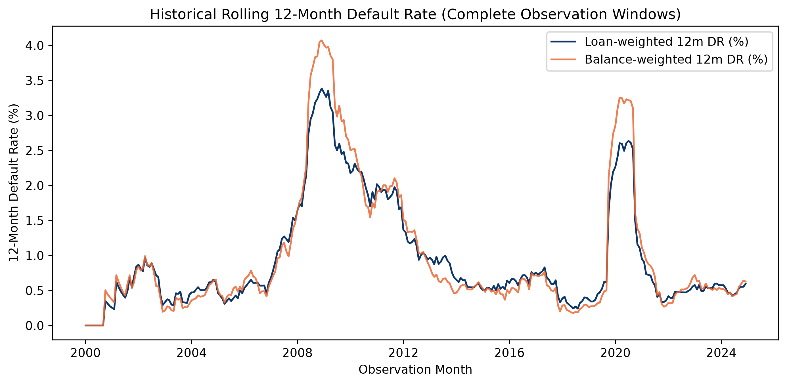
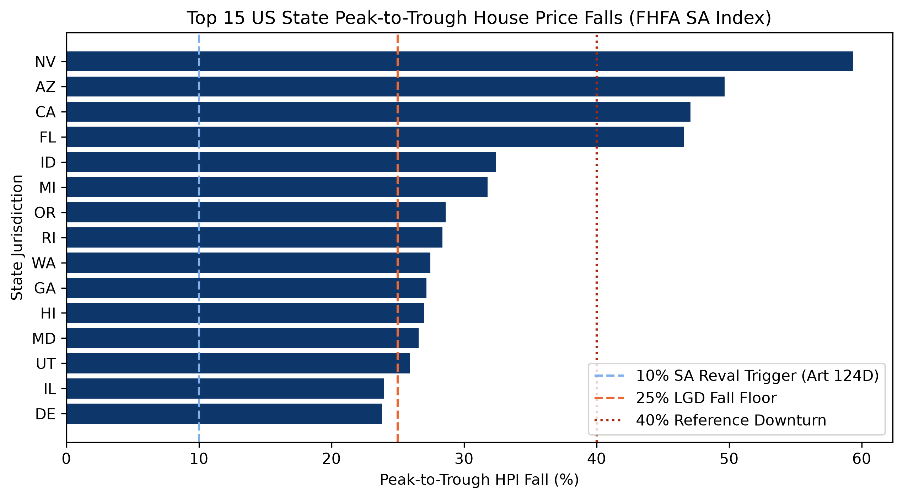
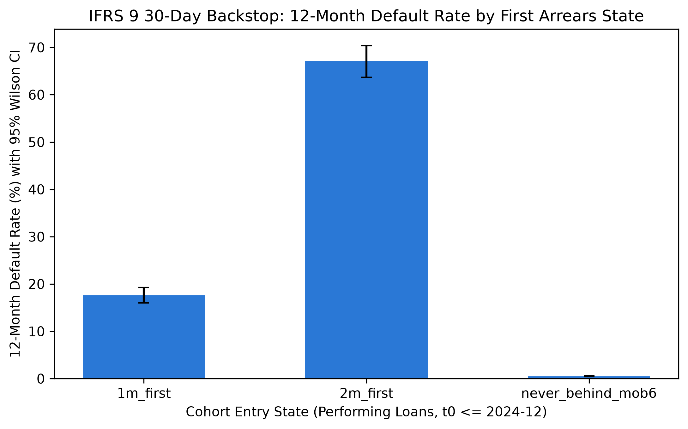
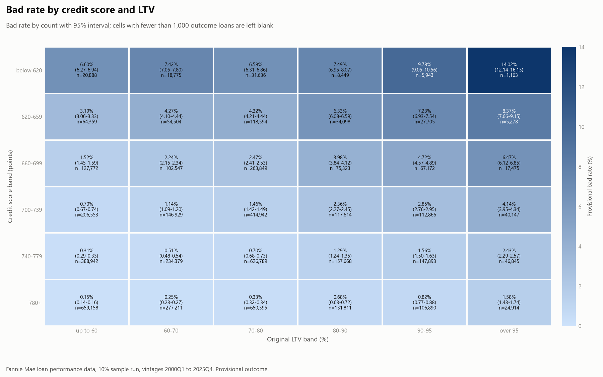
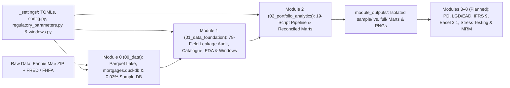

# V4 Bank Credit Risk Platform

[](requirements.txt)
[](requirements.txt)
[](residential_mortgage/01_data_foundation/01_ingestion_design.md)
[](residential_mortgage/_settings/regulatory_parameters.py)

An end-to-end **UK PRA / CRR / IFRS 9 residential mortgage credit risk platform** evaluated empirically against **26 years of US Fannie Mae loan performance histories (`2000Q1`–`2025Q4`)**, built on DuckDB + ZSTD Parquet with a self-contained stratified sample database committed in Git.

> **Sample-First & Clone-Ready:** Every script and notebook defaults to the **0.03% per-quarter stratified sample DuckDB** (`42.01 MB`, tracked in Git) with identical table schemas (`loans_table`, `loan_monthly_view`, full macro & catalogue tables), so anyone cloning this repo can execute the analytics pipeline, notebooks, and unit tests locally without downloading 90 GB of raw files.

---

## At a Glance

### Data Scale & Engineering Footprint

| Store / Dataset | Scale | Storage & Git Policy |
|---|---|---|
| **Full Loan Performance Lake** | `57,597,528` unique loans · `3,314,483,004` monthly rows · `104` quarters (`2000Q1`–`2025Q4`) · `USD 12.63T` original UPB | `~26.04 GB` ZSTD Parquet + `~2.06 GiB` `mortgages.duckdb` *(gitignored; `--full` opt-in)* |
| **Stratified Sample DB (`0.03%`)** | `17,275` unique loans across all `104/104` quarters · `994,063` monthly rows behind `loan_monthly_view` | `42.01 MB` `mortgages_sample.duckdb` + `26.51 MB` `module2_sample.duckdb` *(tracked in Git)* |
| **Macroeconomic & HPI Series** | `322` monthly rows (`FEDFUNDS`, `UNRATE`) · `5,406` quarterly state HPI rows (`51` states/DC, FHFA) | Stored directly in both DBs (`macro_monthly_table`, `macro_state_hpi_table`, `macro_economic_mart`) |

### Headline Portfolio Findings (`0.03%` Stratified Sample)

> Metrics queried directly from Module 2 reconciled marts in [18_portfolio_findings.md](residential_mortgage/00_data/processed/module_outputs/02_portfolio_analytics/sample/18_portfolio_findings/18_portfolio_findings.md). Statistical estimates carry 95% confidence intervals and method notes where applicable.

| Domain | Observed Metric (`0.03%` Sample) | Source Mart |
|---|---|---|
| **Long-Run 12m PD** | `0.9747%` count-weighted across complete windows (`<= 2024-12`) | `default_rate_history_mart` |
| **Asset Correlation** | `0.0553` implied Vasicek $\rho$ vs. `0.1500` CRR retail residential IRB benchmark | `implied_correlation_mart` |
| **IFRS 9 30-Day Backstop** | `2m_first` 12m conversion `67.10%` (`95% CI: 63.69%–70.34%`, Wilson; `512/763`) vs. `0.50%` (`0.40%–0.62%`) for current accounts | `roll_30day_evidence_mart` |
| **State HPI Downturn** | Worst peak-to-trough declines: `NV -59.4%`, `AZ -49.7%`, `CA -47.1%`, `FL -46.6%` (`2006`–`2011`) | `state_hpi_peaktotrough_mart` |
| **Workout Severity & FSD** | `28.21%` net loss severity (`USD 10.02M` loss / `USD 35.52M` UPB across `231` credit exits); `46.17%` mean forced-sale discount (`210` liquidations) | `default_outcomes_mart` |
| **Macro Lead-Lag Link** | Peak 12m DR correlation with `UNRATE` at lag 3m ($r = +0.689$) and national HPI YoY change at lag 9m ($r = -0.616$) | `economy_correlations_mart` |

---

## Visual Showcase (`0.03%` Stratified Sample)

| Default Rate History & Downturns | State Peak-to-Trough HPI Drawdowns |
| :---: | :---: |
|  |  |
| *Rolling 12m default rate & Vasicek downturn framing (`07_default_rate_history.py`)* | *FHFA state house-price peak-to-trough falls (`06_current_ltv.py`)* |
| **IFRS 9 30-Day Arrears Conversion** | **Credit Score × Original LTV Risk Grid** |
|  |  |
| *12m & lifetime default conversion by initial delinquency (`03_roll_rates.py`)* | *Provisional 24m outcome bad rate across FICO & LTV bands (`02_eda.ipynb`)* |

---

## Architecture Pipeline



- **DuckDB + Parquet Split:** Full production runs (`--full`) keep monthly records compressed in quarterly ZSTD Parquet behind `loan_monthly_view`, while default sample runs execute standalone against `mortgages_sample.duckdb`.
- **Single Source of Truth:** All operational knobs (`paths.toml`, `sampling.toml`, `compute.toml`, `sources.toml`), regulatory rules (`regulatory_parameters.py`), and time windows (`windows.py`) live together in [residential_mortgage/_settings/](residential_mortgage/_settings/).
- **Leakage Quarantine Before Modeling:** `03_leakage_audit.py` locks all `78` schema columns (`33` origination, `21` lagged `t-1` monthly, `19` quarantined target-only outcome/loss columns, `5` join/time keys) in `field_leakage_table`.

---

## UK Regulatory Scope & US Data Departures

Loan collateral and macro series (`FEDFUNDS`, `UNRATE`, FHFA HPI) are USD/US series evaluated under **UK PRA Rulebook** (CRR / IRB / SA / CRM effective Jan 2027), **SS11/13**, **SS4/24**, **PS9/24**, **IFRS 9**, **BoE BCST**, and **SS1/23**. All `15` mapped departures are tracked in [regulatory_parameters.py](residential_mortgage/_settings/regulatory_parameters.py):

| Rule Area | UK PRA / IFRS 9 Rule | US Fannie Mae Adaptation |
|---|---|---|
| **Default Trigger** | `> 90` days past due; `£0 / 0%` retail materiality | Whole-month delinquency `>= 3` (`90–119` DPD), `N -> Y` modification flag, or credit exit `("02","03","09","15")` |
| **Probation Windows** | `3m` non-restructuring (Art. 178(5)(a)); `12m` distressed restructuring (Art. 178(5A)) | Implemented directly in [02_default_engine.py](residential_mortgage/02_portfolio_analytics/scripts/02_default_engine.py) |
| **COVID Payment Deferrals** | FCA/PRA `6m` hard cap (`2020-03-01` to `2021-03-31` start, `2021-07-31` end) | Overlaid onto longer US CARES Act forbearance plans in both `as_reported` and `covid_adjusted` tracks |
| **LGD Discount Rate** | Long-run `SONIA + 5%`; downturn `>= 9%` | Long-run `ROUND(FEDFUNDS + 5, 4)`; downturn `GREATEST(9, FEDFUNDS + 5)` in [03_build_macro_tables.py](residential_mortgage/00_data/scripts/03_build_macro_tables.py) |
| **Collateral Valuation** | Residential revaluation every `<= 5` years & immediate check on `> 10%` drop | Quarterly FHFA state HPI indexation with downward-only tracking in [06_current_ltv.py](residential_mortgage/02_portfolio_analytics/scripts/06_current_ltv.py) |

> Paragraph-level PRA Rulebook / SS4/24 wording verification flags are documented inline in [regulatory_parameters.py](residential_mortgage/_settings/regulatory_parameters.py) ahead of Modules 3–7 sign-off.

---

## Module Roadmap (`0`–`8`)

| # | Module | Location | Status | Highlights |
|---|---|---|---|---|
| **0** | **Data Ingestion & Sample DB** | [00_data/](residential_mortgage/00_data/) | **Complete** | 113-field layout mapper, ZSTD Parquet builder, FRED/FHFA macro + PRA discount loader, `0.03%` sample builder |
| **1** | **Data Foundation** | [01_data_foundation/](residential_mortgage/01_data_foundation/) | **Complete (Sample)** | Leakage audit (`78` fields), feature catalogue, `02_eda.ipynb` (`8/8 PASS`), `05_observation_windows.ipynb` *(macro pub-lag enforcement open ahead of M3)* |
| **2** | **Portfolio Analytics** | [02_portfolio_analytics/](residential_mortgage/02_portfolio_analytics/) | **Built & Verified** | `19` scripts (`00`–`18`) producing marts, snapshots, findings + `14/14` synthetic known-answer unit tests (`--full` opt-in) |
| **3** | **Rating & PD** | [03_rating_and_pd/](residential_mortgage/03_rating_and_pd/) | **Planned** | Application & behavioural scorecards, PIT/TTC PD, 15-grade scale, Pluto-Tasche validation (`7` stubs) |
| **4** | **LGD & EAD** | [04_lgd_ead/](residential_mortgage/04_lgd_ead/) | **Planned** | Workout & SS4/24 component LGD, `5%` floor, EL waterfall (`3` stubs) |
| **5** | **IFRS 9 ECL** | [05_ifrs9_ecl/](residential_mortgage/05_ifrs9_ecl/) | **Planned** | Stage 1/2/3 SICR triggers, Aalen-Johansen lifetime PD, multi-scenario ECL (`5` stubs) |
| **6** | **Basel 3.1 Capital** | [06_basel_capital/](residential_mortgage/06_basel_capital/) | **Planned** | SA loan-splitting, retail AIRB ASRF, output floor, Euler EC / RAROC (`3` stubs) |
| **7** | **Stress Testing** | [07_stress_testing/](residential_mortgage/07_stress_testing/) | **Planned** | ARDL macro satellites, Vasicek inversion, 5y BoE BCST projection, reverse stress (`3` stubs) |
| **8** | **Model Risk Management** | [08_model_risk_mgmt/](residential_mortgage/08_model_risk_mgmt/) | **Planned** | PRA SS1/23 / SR 11-7 inventory, conceptual soundness, monitoring (`2` stubs) |

---

## 30-Second Quickstart

From the cloned repository root on Windows PowerShell (Python **3.12+**):

```powershell
python -m venv .venv
.venv\Scripts\Activate.ps1
pip install -r requirements.txt

# Run all 14 synthetic known-answer tests + the 19-script Module 2 sample pipeline (0.03% DB)
.venv\Scripts\python.exe residential_mortgage\02_portfolio_analytics\tests\test_module2.py
.venv\Scripts\python.exe residential_mortgage\02_portfolio_analytics\run_module2.py
```

For step-by-step instructions across every module, notebook toggles (`EDA_FULL`, `WIN_FULL`), and `--full` execution, see the **[Technical Operator Runbook](residential_mortgage/README.md)**.

---

## Repository Structure & Key Links

```text
V4_bank-credit-risk-platform/
├── README.md                                  # Platform overview & showcase
├── requirements.txt                           # Pinned Python dependencies (DuckDB 2.0.0, pandas 3.1.1, matplotlib 3.11.2, Jupyter)
├── .gitignore                                 # Excludes full DBs, Parquets, CSVs, .scratch/ & docs/; tracks 0.03% sample DBs & PNG charts
├── references/
│   └── fannie_mae_glossary_file_layout.pdf    # Official Fannie Mae 113-field layout & glossary
└── residential_mortgage/                      # Core platform package (see residential_mortgage/README.md)
    ├── _settings/                             # paths/sampling/compute/sources.toml + config.py + regulatory_parameters.py + windows.py
    ├── 00_data/                               # Ingestion, macro tables, sample builder & module_outputs/
    ├── 01_data_foundation/                    # Leakage audit, feature catalogue, EDA & window notebooks
    ├── 02_portfolio_analytics/                # 19-script pipeline + 14 unit tests
    └── 03_rating_and_pd/ .. 08_model_risk_mgmt/
```

| Document | Description |
|---|---|
| [residential_mortgage/README.md](residential_mortgage/README.md) | Complete developer guide, `_settings/` reference & all execution commands |
| [residential_mortgage/00_data/README.md](residential_mortgage/00_data/README.md) | Module 0 ingestion scripts & data folder guide |
| [residential_mortgage/01_data_foundation/01_ingestion_design.md](residential_mortgage/01_data_foundation/01_ingestion_design.md) | DuckDB + Parquet storage design & scan benchmarks |
| [residential_mortgage/02_portfolio_analytics/README.md](residential_mortgage/02_portfolio_analytics/README.md) | Module 2 script-by-script reference & mart DAG (`00`–`18`) |
| [18_portfolio_findings.md](residential_mortgage/00_data/processed/module_outputs/02_portfolio_analytics/sample/18_portfolio_findings/18_portfolio_findings.md) | Auto-generated empirical summary from Module 2 sample marts |
| [references/fannie_mae_glossary_file_layout.pdf](references/fannie_mae_glossary_file_layout.pdf) | Source Fannie Mae 113-field schema specification |
