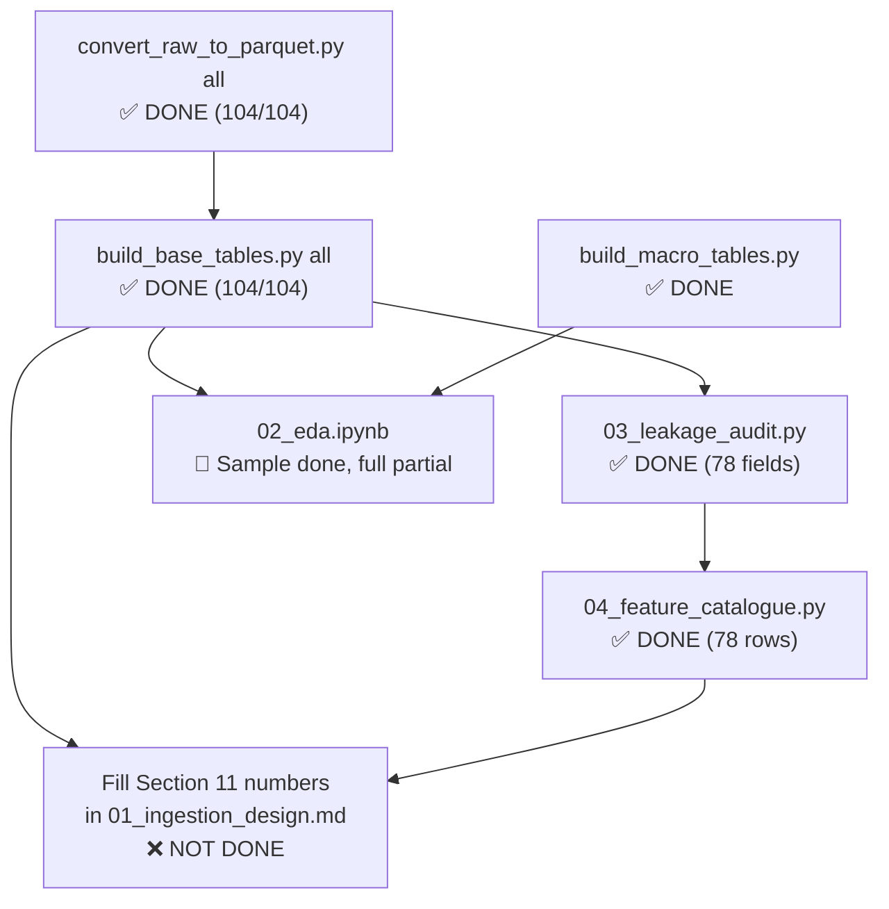

# Data Module & Module 1 — Detailed Audit

> **Assessed:** 15 Nov 2026, 16:06 IST  
> **Re-verified:** 24 Nov 2026 — ingestion complete, EDA/leakage/catalogue run

---

## Script-by-Script Status

### ✅ `00_data/field_map.py` — DONE, works

- Maps all 113 Fannie Mae positions to column names, dtypes, and targets (`loans`, `loans_first`, `loan_monthly`, `not_loaded`).
- Self-validates position continuity (1–113) and unique names.
- 269 lines. Imported by every other script.
- **No issues.**

---

### ✅ `00_data/convert_raw_to_parquet.py` — DONE, all 104 quarters converted

- 615 lines. Extracts CSV from zip → `.scratch/` → ZSTD-compressed Parquet → atomically renames.
- **104 Parquet files** in `raw/parquet/` ✅
- **104 conversion records** (`*.conversion.json`) ✅
- Measured: 38–53 s/GB, 30x–41x compression.
- **No issues. Fully complete.**

---

### ✅ `00_data/build_base_tables.py` — DONE, all 104 quarters loaded

- 727 lines. Reads Parquet → builds `loans_table`, `loan_monthly_view`, `sampled_loans_table`, runs 8 integrity checks per quarter in one atomic transaction.
- **All 104 quarters loaded** (2000Q1 → 2025Q4), every one 8/8 checks PASS — zero failures.
- **Final counts:** `loans_table` 57,597,528 loans; `sampled_loans_table` 5,759,759 (10% sample); `loaded_quarters_table` 104 entries; ~3.31 billion monthly rows; $12.63T total UPB reconciled to the cent.
- **Total load time:** ~4.74h. DuckDB ~2.06 GB; Parquet lake ~26.04 GB.

---

### ✅ `00_data/build_macro_tables.py` — DONE, works

- 609 lines. Loads FEDFUNDS, UNRATE, FHFA HPI Master into DuckDB.
- Built and verified: 6/6 checks PASS (in 3.14s).
- **Tables in DuckDB:**
  - `macro_monthly_table`: 322 months (2000-01 → 2026-10)
  - `macro_state_hpi_table`: 5,406 rows (51 states × 106 quarters)
  - `macro_monthly_view`: view over the monthly table
  - `macro_economic_mart`: mart with 1m/12m deltas + LGD discount rates
  - `macro_sources_table`: source provenance
- **No issues. Fully complete.**

---

### ✅ `01_data_foundation/02_eda.ipynb` — RUN

- Jupyter notebook (not a `.py` script). 16-section Master EDA.
- **Sample run complete:** `02_eda_outputs_sample/` holds 34 charts + 56 tables = **90 outputs**.
- **Full-population run partial:** `02_eda_outputs/` holds 4 charts + 12 tables = **16 outputs** (Section 02 only, so far).
- The notebook uses a **provisional outcome** (`build_loan_outcome()`) for bad rates, IV, and PSI — this is a temporary stand-in until Module 2 builds `default_events_mart` with the real default definition.
- **Depends on:** `loans_table` and `loan_monthly_view` being populated (now true for all 104 quarters).
- **Remaining action:** Run the remaining sections on all 104 quarters.

---

### ✅ `01_data_foundation/03_leakage_audit.py` — DONE, ran

- 250 lines. Classifies every field into `origination` / `monthly_lag_1` / `quarantined` / `key`.
- Produced `field_leakage_table` in DuckDB — **78 rows**: 33 origination, 21 monthly_lag_1, 19 quarantined, 5 key.
- Hard-coded classifications (not data-driven) — reads field_map and writes the classification table.
- **Depends on:** `loans_table` and `loan_monthly_view` (both populated).

> [!NOTE]
> The macro data publication lag (unemployment ~1 month, HPI ~2 months) is flagged in the module-1-design as needing enforcement in this audit, but the current script **only classifies loan fields**, not macro fields. Either this script or a later addition needs to handle macro lag rules.

---

### ✅ `01_data_foundation/04_feature_catalogue.py` — DONE, ran

- 296 lines. Reads `field_leakage_table` → produces `feature_catalogue_table` in DuckDB + exports `docs/module_1/feature_catalogue.md`.
- **Produced `feature_catalogue_table` (78 rows)** and `docs/module_1/feature_catalogue.md` (exists).
- **Depends on:** `field_leakage_table` (from `03_leakage_audit.py`).

---

## What Is In DuckDB Right Now

| Object | Type | Status |
|:---|:---|:---|
| `loans_table` | TABLE | ✅ 104 quarters loaded — 57,597,528 loans |
| `loan_monthly_view` | VIEW | ✅ Over loaded Parquet files, recomputed each run |
| `sampled_loans_table` | TABLE | ✅ 10% subset — 5,759,759 loans |
| `loaded_quarters_table` | TABLE | ✅ 104 entries |
| `origination_restatements_table` | TABLE | ✅ 1,558 restatements tracked |
| `macro_monthly_table` | TABLE | ✅ 322 months |
| `macro_state_hpi_table` | TABLE | ✅ 5,406 rows |
| `macro_monthly_view` | VIEW | ✅ Working |
| `macro_economic_mart` | TABLE | ✅ 322 rows with discount rates |
| `macro_sources_table` | TABLE | ✅ Source provenance |
| `field_leakage_table` | TABLE | ✅ 78 rows (33/21/19/5) |
| `feature_catalogue_table` | TABLE | ✅ 78 rows |

---

## What Is In `docs/module_1/`

| File | Status |
|:---|:---|
| `module-1-plan.md` | ✅ Written, updated for D-020/D-025 |
| `module-1-design.md` | ✅ Written, comprehensive (286 lines, measured numbers from 2005Q1 and 2019Q1) |
| `feature_catalogue.md` | ✅ Exists — exported by `04_feature_catalogue.py` |

---

## Execution Sequence To Finish Module 1

### Ordered to-do list

| # | Action | Blocking on | Est. time |
|:---|:---|:---|:---|
| 1 | ✅ `build_base_tables.py all` finished | — | Done (~4.74h) |
| 2 | ✅ `03_leakage_audit.py` ran | — | Done |
| 3 | 🔄 `02_eda.ipynb` — sample done (90 outputs); finish full run | — | ~30 min (full) |
| 4 | ✅ `04_feature_catalogue.py` ran | — | Done |
| 5 | Fill "Section 11" measured numbers in `01_ingestion_design.md` | Step 1 | Manual, query DuckDB |
| 6 | Time 3 benchmark queries on `loan_monthly_view` | Step 1 | Minutes |
| 7 | Review EDA outputs for data quality surprises | Step 3 | Manual review |

### Items 1, 2 and 4 are complete; items 3 (full EDA run), 5, 6 and 7 remain. Module 2 can start.

---

## Things That Work Well

- **Ingestion pipeline is bulletproof.** 104 quarters loaded, every single one 8/8 PASS. Zero failures. Exact UPB reconciliation to the cent on every quarter.
- **Resumability.** Both stages skip already-done quarters. A crash loses at most the quarter in progress.
- **Conversion records.** Every Parquet file has a `.conversion.json` sidecar with provenance.
- **Macro pipeline.** Clean, atomic, 6 checks, properly documents all UK rule departures.
- **Naming convention.** Consistent `*_table`, `*_view`, `*_mart` throughout.

## Things To Watch

- **The full-population EDA run is incomplete.** The 10% sample run produced all 90 outputs; the full run has only reached Section 02 (16 outputs). The remaining sections still need to run on all 104 quarters. The provisional outcome builder (`build_loan_outcome()`) is a placeholder.
- **Leakage audit doesn't cover macro fields.** The design doc says macro lags must be enforced, but the script only classifies loan-level columns.
- **Section 11 of the design doc is blank.** Total rows, total loans, DuckDB size, query benchmarks — all marked "To fill after the full load."
- **`loan_monthly_view` uses absolute Parquet paths.** Moving the repo breaks the view. The script documents this: "moving the repo needs one rerun to refresh paths."
