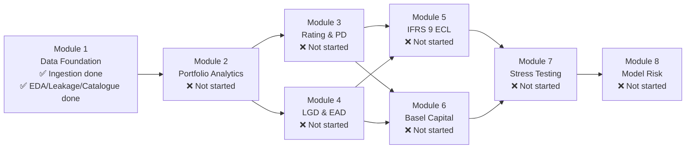

# V4 Bank Credit Risk Platform — Where Things Stand

> **Project registered:** 14 November 2026  
> **Last verified:** 24 November 2026  

---

## TL;DR

The **build plan** is complete and reviewed (8 modules, 33 build steps). The actual **code** now covers the whole **data foundation** — `00_data` (ingestion pipeline) plus `01_data_foundation` (EDA, leakage audit, feature catalogue) — and it has all been run and verified. Everything from **Module 2 (portfolio analytics) onwards is unbuilt**. The repo is a finished blueprint with a complete, verified data foundation.

---

## What Is Built (code exists and runs)

| Layer | Script | What it does | Status |
|:---|:---|:---|:---|
| Field map | `00_data/field_map.py` | 113-field Fannie Mae layout → clean column names + dtypes | ✅ Done |
| Stage 1 | `00_data/convert_raw_to_parquet.py` | Extracts CSV from zip → compressed Parquet per quarter | ✅ Done — all 104 quarters (2000Q1–2025Q4) |
| Stage 2 | `00_data/build_base_tables.py` | Builds `loans_table`, `loan_monthly_view`, `sampled_loans_table`, 8 integrity checks | ✅ Done — all 104 quarters loaded (57.6M loans, 8/8 checks pass) |
| Stage 3 | `00_data/build_macro_tables.py` | Downloads FEDFUNDS, UNRATE, FHFA HPI → macro tables & mart with LGD discount rates | ✅ Done — 6/6 checks pass |
| Foundation docs | `01_data_foundation/01_ingestion_design.md` | Ingestion design document | ✅ Done |
| EDA notebook | `01_data_foundation/02_eda.ipynb` | 16-section Master EDA | ✅ Run — sample run complete (90 outputs); full run partial (16 outputs, Section 02 only) |
| Leakage audit | `01_data_foundation/03_leakage_audit.py` | Classifies 78 fields (33 origination / 21 monthly_lag_1 / 19 quarantined / 5 key) → `field_leakage_table` | ✅ Done — 78 rows |
| Feature catalogue | `01_data_foundation/04_feature_catalogue.py` | Reads leakage table → `feature_catalogue_table` + `docs/module_1/feature_catalogue.md` | ✅ Done — 78 rows |

### DuckDB Schema (in `mortgages.duckdb`)

```
loans_table                     ← Materialized (104 quarters, 57,597,528 loans)
loan_monthly_view               ← View over Parquet files
sampled_loans_table             ← 10% seeded sample
loaded_quarters_table           ← Audit ledger
origination_restatements_table  ← Mid-life restatement tracking
macro_monthly_table             ← National monthly (322 months)
macro_state_hpi_table           ← State quarterly HPI (5,406 records)
macro_monthly_view              ← View over macro series
macro_economic_mart             ← Mart with deltas + PRA discount rates
```

---

## What Is Planned But Not Built

Every module folder below is **empty** — the build plan describes them in full detail but no code exists yet.

| Module | Folder | Steps | Key Deliverables |
|:---|:---|:---|:---|
| **1 — Portfolio Analytics** | `02_portfolio_analytics/` | 5–9 | Stock-and-flow audit, default engine + probation state machine, Markov roll rates, vintage curves (Aalen-Johansen CIF), concentration grids |
| **2 — Rating & PD** | `03_rating_and_pd/` | 10–16 | Application scorecard (WoE/IV, 50:1@650), behavioural scorecard, standalone PIT PD, TTC PD, calibration + cyclicality, 15-grade master scale, model validation (binomial, Pluto-Tasche, MoC) |
| **3 — LGD & EAD** | `04_lgd_ead/` | 17–19 | Workout LGD (EFFR+500bps, 9% floor), component LGD (SS4/24 Ch.15), EL waterfall + EL↔ECL bridge |
| **4 — IFRS 9 ECL** | `05_ifrs9_ecl/` | 20–24 | SICR staging, lifetime PD term structure, scenario LGD/EAD, multi-scenario ECL, movement waterfall |
| **5 — Basel Capital** | `06_basel_capital/` | 25–27 | Standardised RWA (Art.124F/G), AIRB Vasicek, economic capital + RAROC |
| **6 — Stress Testing** | `07_stress_testing/` | 28–30 | ARDL satellite models, 5-year capital projection (BoE 2025 BCST), reverse stress test |
| **7 — Model Risk Mgmt** | `08_model_risk_mgmt/` | 31–32 | Model inventory (SS1/23), conceptual soundness docs, validation reports, monitoring dashboard |
| **Final** | `README.md` | 33 | Institutional showpiece README |

---

## Current State of the Data Foundation

1. **Ingestion is complete.** `convert_raw_to_parquet.py all` finished all 104 quarters (2000Q1–2025Q4), and `build_base_tables.py all` loaded every quarter into `loans_table`: **57,597,528 unique loans**, ~**3.31 billion** monthly rows, **$12.63T** total UPB reconciled to the cent, with 8/8 integrity checks passing on every quarter. Total load ~4.74h; DuckDB ~2.06 GB; Parquet lake ~26.04 GB.

2. **Macro tables are built and verified** (6/6 checks): `macro_monthly_table` 322 months, `macro_state_hpi_table` 5,406 rows, `macro_economic_mart` with LGD discount rates.

3. **EDA, leakage audit and feature catalogue have all run.** The 16-section Master EDA completed on the 10% sample (34 charts + 56 tables = 90 outputs); a full-population run has reached Section 02 so far (4 charts + 12 tables = 16 outputs). The leakage audit classified 78 fields (33 origination / 21 monthly-lag-1 / 19 quarantined / 5 key) into `field_leakage_table`, and the feature catalogue produced `feature_catalogue_table` (78 rows) plus `docs/module_1/feature_catalogue.md`.

---

## Known Issues Still Open

From [known_issues.md](file:///E:/Repos/V4_bank-credit-risk-platform/docs/known_issues.md):

| Issue | Summary |
|:---|:---|
| Probation query bug | `modification_flag` stays 'Y' forever once set — the recursive CTE can never cure a modified loan. Trigger must fire on the *change* from N→Y, not the flag's current value. |
| Investor risk weights | Missing the 60–70% LTV band (40% RW) from Art.124G Table 6B — 7 bands collapsed to 6. |
| Forced-sale discount | Double-counted in component LGD — SS4/24's 40% reference already includes it. |
| Balance sheet | CET1 of 765 at 14% implies RWA ≈ 5,460 (avg weight ~55%), but Art.124F gives much less. CET1 should derive from computed RWA. |
| Data size understated | ~4× undercount — 20M loans × ~50 months avg life ≈ 1B rows, not 250M. |
| Unrun results written as fact | "Empirical finding: cure rates decline steeply" etc. — approved for rewriting (15C) but not done. |
| PD design vs SS4/24 | "Cycle-neutral" label contradicts §11.41 for mortgages. Cyclicality formula isn't PRA's measure. 30% is the cap on *imputed* cyclicality. |
| Citation errors | Multiple PRA article/paragraph references need correction (listed in detail). |
| IFRS 9 probation staging | Probation loans are Stage 3, not Stage 2. 30 DPD backstop is rebuttable, not mandatory. |
| Macro data lag leakage | Unemployment (~1 month) and HPI (~2 months) publication lags need to be enforced in the leakage audit. |

---

## What To Build Next & How

### Module 1 (data foundation) is complete — remaining loose ends

1. **Finish the full-population EDA run.** The 10% sample run is complete (90 outputs); the full run has only reached Section 02 so far (16 outputs). Run the remaining sections of `02_eda.ipynb` against all 104 quarters.

2. **Fill the measured numbers into `01_ingestion_design.md` Section 11** (total rows, loans, DuckDB size, query benchmarks), which was left as "to fill after the full load".

### Then: Module 2 — Portfolio Analytics (Steps 5–9)

This is the natural next build block. Depends on completed Module 1. The build order is:

```
Step 5:  01_data_audit.py       ← Stock-and-flow UPB reconciliation
Step 6:  02_default_engine.py   ← Business default + probation state machine
                                  ⚠️ Fix the modification_flag bug FIRST
Step 7:  03_roll_rates.py       ← Markov transition matrix
Step 8:  04_vintage_curves.py   ← CDR, CPR/SMM, Aalen-Johansen CIF
Step 9:  05_concentrations.py   ← HHI, risk grids, EPD-3
```

> [!IMPORTANT]
> The probation state machine in the build plan has a confirmed bug: it treats `modification_flag == 'Y'` as a *current state* check, but Fannie Mae sets this flag permanently once a loan is modified. The trigger must fire on the *transition* from N→Y. This must be fixed before building `02_default_engine.py`. Confirm the flag behaviour against `references/fannie_mae_glossary_file_layout.pdf` first.

### Broader Sequence



---

## Key Files To Know

| File | Purpose |
|:---|:---|
| [v4_build_plan_revised.md](file:///E:/Repos/V4_bank-credit-risk-platform/docs/v4_build_plan_revised.md) | The master blueprint — all 33 steps, formulas, SQL, regulatory citations |
| [known_issues.md](file:///E:/Repos/V4_bank-credit-risk-platform/docs/known_issues.md) | Open bugs and review findings against the build plan |
| [departures_from_uk_rules.md](file:///E:/Repos/V4_bank-credit-risk-platform/docs/departures_from_uk_rules.md) | 8 documented departures where US data meets UK rules |
| [corrections_change_log.md](file:///E:/Repos/V4_bank-credit-risk-platform/docs/corrections_change_log.md) | Audit trail of all 14 reviewer findings + 6 Block E fixes |
| [DECISIONS.md](file:///E:/Repos/.agent/projects/v4-bank-credit-risk-platform/DECISIONS.md) | 22 project decisions (D-001 through D-022) |
